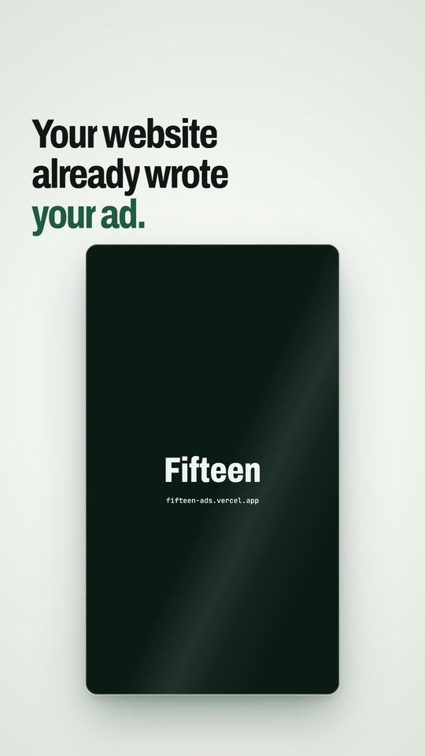

# Fifteen

Paste a business's website and get a 15-second motion ad made from its own words, colours and logo. Free, no
sign-up.

**Live:** https://fifteen-ads.vercel.app



## How it works

- **Reading the site** (`lib/scan.ts`): the header logo (inline SVG too), brand colours ranked by how much they're
  used and how saturated they are (CSS variables named brand, primary or accent win), the headings, and long
  paragraphs split into short lines an ad can use.
- **Safe fetching** (`lib/safe-fetch.ts`): resolves the host and refuses private, loopback and cloud-metadata
  addresses on every redirect hop. (It checks the address before fetching rather than pinning it, so DNS
  rebinding is still a known gap.) Sites that block tools get a "type the words in yourself" fallback.
- **One drawing function** (`lib/ad.ts`): the ad is a pure function of time drawn on a canvas. The same function
  drives the preview, the saved file and the launch video.
- **Frame-exact saving** (`lib/record.ts`): WebCodecs `VideoEncoder` plus mp4-muxer writes all 450 frames, exactly
  15.000 seconds, with no dropped frames. MediaRecorder is only the fallback.

## Stack

Next.js 16, TypeScript, plain CSS, canvas, WebCodecs.

## Running it

```bash
npm install
npm run dev
```
